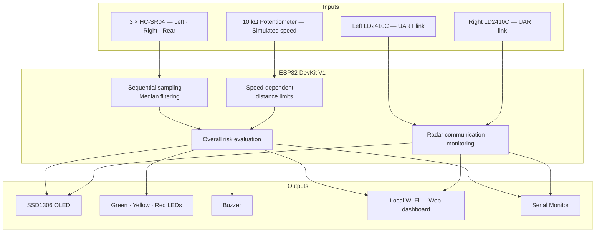
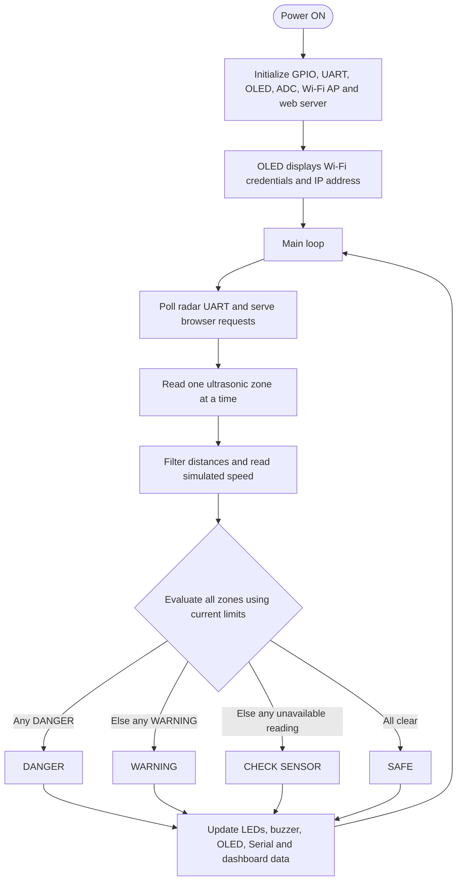

# Intelligent Blind-Spot Detection System

**ESP32 · Three-Zone Proximity Monitoring · Speed-Adaptive Alerts · Live Web Dashboard**

**A tabletop embedded-systems prototype that monitors obstacles on the left, right, and rear of a vehicle model, adapts warning thresholds to simulated speed, and presents live feedback through an OLED, LEDs, buzzer, and an ESP32-hosted browser dashboard.**

---

## Overview

This project demonstrates a compact **three-zone blind-spot proximity warning system** built around an **ESP32 DevKit V1**. Three **HC-SR04 ultrasonic sensors** measure nearby object distances. A **10 kΩ potentiometer** simulates vehicle speed, allowing the ESP32 to increase its warning and danger distances as the simulated speed rises.

Two **HLK-LD2410C mmWave radar modules** are connected to dedicated hardware UARTs. The firmware monitors their communication status. **The current warning decisions are based on ultrasonic measurements, not radar target readings or radar–ultrasonic sensor fusion.**

The system provides an integrated demonstration of sensor interfacing, filtering, threshold-based decisions, GPIO control, I²C display output, UART communication, and self-hosted IoT monitoring. No internet service, cloud account, or external server is required for the dashboard.

## 📸 System Image


## 🎥 Demonstration Video

[▶ Watch the complete working demonstration on YouTube](https://youtu.be/mdBXOJ1Ovow)

## Key Features

- **Three-direction monitoring:** independent left, right, and rear proximity measurements.
- **Filtered distance readings:** sequential ultrasonic triggering and a three-sample median filter.
- **Speed-adaptive thresholds:** three distance profiles driven by a 0–100 km/h simulated speed input.
- **Visual alerts:** green (**SAFE**), yellow (**WARNING**), and red (**DANGER**) LEDs.
- **Audible alerts:** non-blocking buzzer patterns for warning, danger, and sensor-check conditions.
- **Live OLED:** 128 × 64 SSD1306 display for zone readings, simulated speed, system status, and radar UART connectivity.
- **Easy dashboard access:** Wi-Fi network credentials and the ESP32 IP address appear on the OLED until the browser dashboard is opened.
- **Responsive web dashboard:** current distances, risk state, simulated speed, threshold values, radar connection states, browser-session history graphs, and event changes.
- **Serial diagnostics:** regular monitoring output at 115200 baud.

## System Architecture



> **Detection method:** Ultrasonic distances are used for proximity classification. The LD2410C modules provide communication-status information in this firmware; their target readings are not used in the alert decision path.

## Hardware Components

| Component                                          | Quantity  | Role                                          |
| -------------------------------------------------- | --------- | --------------------------------------------- |
| ESP32 DevKit V1                                    | 1         | Main controller and Wi-Fi access point        |
| HC-SR04 ultrasonic sensor                          | 3         | Left, right, and rear distance measurement    |
| HLK-LD2410C mmWave radar module                    | 2         | UART-connected radar modules; link monitoring |
| SSD1306 OLED, 128 × 64, I²C                        | 1         | Local status and network information          |
| LEDs: green, yellow, red                           | 3         | Overall warning indication                    |
| 220 Ω LED resistors                                | 3         | LED current limiting                          |
| Active buzzer module                               | 1         | Audible alerts                                |
| 10 kΩ linear potentiometer                         | 1         | Simulated vehicle-speed input                 |
| Resistors for ECHO level shifting                  | 6         | Three 5 V-to-3.3 V voltage dividers           |
| Regulated 5 V supply, jumper wires, mounting board | As needed | Power and assembly                            |

## GPIO Pin Connections

The following assignments match the completed firmware.

| Module        | Module signal       | ESP32 GPIO | Notes                         |
| ------------- | ------------------- | ---------- | ----------------------------- |
| Left LD2410C  | TX → ESP32 RX       | **16**     | HardwareSerial(2)             |
| Left LD2410C  | RX ← ESP32 TX       | **17**     | 256000 baud                   |
| Right LD2410C | TX → ESP32 RX       | **26**     | HardwareSerial(1)             |
| Right LD2410C | RX ← ESP32 TX       | **27**     | 256000 baud                   |
| Left HC-SR04  | TRIG                | **13**     | Digital output                |
| Left HC-SR04  | ECHO                | **34**     | Input through voltage divider |
| Right HC-SR04 | TRIG                | **14**     | Digital output                |
| Right HC-SR04 | ECHO                | **35**     | Input through voltage divider |
| Rear HC-SR04  | TRIG                | **18**     | Digital output                |
| Rear HC-SR04  | ECHO                | **32**     | Input through voltage divider |
| SSD1306 OLED  | SDA                 | **21**     | I²C; address `0x3C`           |
| SSD1306 OLED  | SCL                 | **22**     | I²C                           |
| Green LED     | Anode through 220 Ω | **23**     | SAFE                          |
| Yellow LED    | Anode through 220 Ω | **19**     | WARNING / sensor check        |
| Red LED       | Anode through 220 Ω | **25**     | DANGER                        |
| Buzzer module | IN / signal         | **33**     | Configured active-HIGH        |
| Potentiometer | Centre/wiper        | **36**     | ADC1 analog input             |

### Power and electrical safety

- Power the **HC-SR04** and **LD2410C** modules from a suitable **regulated 5 V** rail according to their module requirements.
- Power the **OLED** and **potentiometer** from **3.3 V**; connect the potentiometer's outer terminals to 3.3 V and GND.
- Connect **all grounds together**.
- **Do not connect an HC-SR04 ECHO pin directly to an ESP32 GPIO.** Use a divider such as **1 kΩ (ECHO → GPIO)** and **2 kΩ (GPIO → GND)** on each of the three ECHO lines.
- Use an appropriate driver if the buzzer's voltage/current requirements exceed what the ESP32 GPIO or onboard 3.3 V supply can support. The sketch assumes an **active-HIGH** buzzer module.
- Confirm the exact **VIN/5 V** pin labeling and power arrangement of your ESP32 development board before connecting external power. Avoid feeding conflicting external and USB supply rails together.

## Speed-Adaptive Warning Logic

The thresholds below are intentionally scaled for a **small plywood-mounted toy-car prototype**. They are not real-vehicle braking or safety distances.

| Simulated vehicle speed | DANGER              | WARNING                     | SAFE             |
| ----------------------- | ------------------- | --------------------------- | ---------------- |
| **0–30 km/h**           | Distance ≤ **5 cm** | 5 cm < distance ≤ **10 cm** | Distance > 10 cm |
| **31–60 km/h**          | Distance ≤ **6 cm** | 6 cm < distance ≤ **12 cm** | Distance > 12 cm |
| **61–100 km/h**         | Distance ≤ **8 cm** | 8 cm < distance ≤ **15 cm** | Distance > 15 cm |

The same limits apply to **LEFT**, **RIGHT**, and **REAR**. Overall status is based on the most urgent detected condition: **DANGER** takes priority, then **WARNING**. If a reading is unavailable and no other zone is in warning or danger, the system reports **CHECK SENSOR**.

| Overall status | LED output      | Buzzer behavior            |
| -------------- | --------------- | -------------------------- |
| SAFE           | Green ON        | OFF                        |
| WARNING        | Yellow ON       | 150 ms ON / 850 ms OFF     |
| DANGER         | Red ON          | 150 ms ON / 150 ms OFF     |
| CHECK SENSOR   | Yellow blinking | 80 ms beep every 3 seconds |

**Example:** At 7 cm from a sensor, the system reports **WARNING** in the 0–30 km/h profile but **DANGER** in the 61–100 km/h profile.

## Web Dashboard

The ESP32 operates as a standalone Wi-Fi access point and serves a **read-only** web interface directly from the firmware.

| Setting                  | Value                                        |
| ------------------------ | -------------------------------------------- |
| Wi-Fi name (SSID)        | `BlindSpot-Pro`                              |
| Wi-Fi password           | `BlindSpot@2026`                             |
| Dashboard URL            | [**http://192.168.4.1**](http://192.168.4.1) |
| Live JSON endpoint       | `http://192.168.4.1/api/status`              |
| Browser refresh interval | Approximately **700 ms**                     |

### How to connect

1. Power the ESP32 and allow the system to initialize.
2. Read the **Wi-Fi name, password, and IP address** on the OLED.
3. On a phone or laptop, connect to the **`BlindSpot-Pro`** network.
4. Open **`http://192.168.4.1`** in a browser.
5. The OLED switches to its live proximity-monitoring screen when dashboard requests are received.
6. If no browser requests arrive for roughly **12 seconds**, the OLED returns to the connection-information screen.

A phone may report **“Connected without internet”**—this is expected for an ESP32-only access point. Remain connected to the local network. The dashboard requires **no cloud connection**.

The web interface displays current distances and risk classifications, simulated speed and active limits, radar UART connectivity, ESP32 uptime, zone history charts, and recent risk transitions. **History and event entries are held in the browser session**, not permanently stored on the ESP32.


## Software and Libraries

- **Arduino IDE 2.x** and an installed **ESP32 board package**
- **Arduino C/C++** on the ESP32
- `Arduino.h`, `WiFi.h`, `WebServer.h`, `Wire.h` (ESP32 environment)
- `ld2410` library (Nick Reynolds)
- `Adafruit GFX Library`
- `Adafruit SSD1306`
- Embedded HTML, CSS, and JavaScript for the responsive dashboard

### Upload procedure

1. Open the tested **`.ino` firmware** from this repository in Arduino IDE. If Arduino IDE asks to create a sketch folder, accept it.
2. Install the required libraries and **ESP32** boards support.
3. Select **Tools → Board → ESP32 Dev Module** (or the appropriate ESP32 DevKit variant).
4. Select the correct **COM / serial port**.
5. Click **Verify**, then **Upload**.
6. Open **Serial Monitor at 115200 baud** for diagnostic output.
7. Connect to the ESP32 Wi-Fi network and open the dashboard address above.

## Firmware Operation



**Timing configured in the sketch:** ultrasonic sensors are triggered sequentially approximately every **65 ms**; the simulated-speed input is updated every **100 ms**; the OLED every **250 ms**; Serial Monitor output every **750 ms**. The browser requests new data approximately every **700 ms**.

## Demonstration and Testing

For a repeatable tabletop test, start with the potentiometer in the **low-speed** range.

| Test               | Action                                                                  | Expected behavior                            |
| ------------------ | ----------------------------------------------------------------------- | -------------------------------------------- |
| Safe condition     | Place an object around 15 cm away                                       | Green LED, buzzer OFF                        |
| Warning condition  | Move it to around 8 cm                                                  | Yellow LED, slow buzzer                      |
| Danger condition   | Move it to around 4 cm                                                  | Red LED, fast buzzer                         |
| Independent zones  | Repeat with left, right, and rear sensors                               | Corresponding zone reading changes           |
| Speed adaptation   | Hold an object around 7 cm away; increase simulated speed above 60 km/h | WARNING changes to DANGER                    |
| OLED handoff       | Start ESP32, then open the dashboard                                    | IP screen switches to live readings          |
| Browser inactivity | Stop browser polling for approximately 12 seconds                       | OLED returns to IP screen                    |
| Radar UART links   | Observe the radar indicators                                            | ONLINE/OFFLINE reflects serial communication |

At distances near **4–5 cm**, ultrasonic measurements depend on target shape, sensor placement, angle, and reflections; allow the median filter to settle and verify the actual reading before judging the result. If an echo is repeatedly unavailable, the system reports a sensor-check condition rather than inventing a distance.

### Example Serial Monitor output

```
================================
 INTELLIGENT BLIND-SPOT SYSTEM
================================

LEFT RADAR  : ONLINE
RIGHT RADAR : ONLINE

VEHICLE SPEED : 20 km/h (SIMULATED)
RISK LIMITS   : DANGER <= 5 cm, WARNING <= 10 cm
-------- SENSOR STATUS --------
LEFT  : 4.6 cm | DANGER
RIGHT : 8.3 cm | WARNING
REAR  : 22.0 cm | SAFE

OVERALL STATUS : DANGER
-------------------------------
```

*The values above are illustrative. The real output depends on your connected sensors.*

## Scope and Limitations

- **Educational prototype only:** not a validated or certified automotive blind-spot warning device.
- **No production sensor fusion:** the proximity alert logic currently uses ultrasonic measurements; radar communication monitoring is separate.
- **Simulated speed:** the potentiometer does not measure actual vehicle speed.
- **Short-range thresholds:** selected for a plywood/toy-car demonstration and not transferable to road vehicles.
- **Environmental sensitivity:** HC-SR04 readings depend on object geometry, alignment, acoustic reflections, and nearby surfaces.
- **Local-only dashboard:** web access is provided over the ESP32's Wi-Fi network; no cloud access, authentication system, or persistent analytics database is implemented beyond the demo AP password.

## Future Enhancements

Possible next steps include validating radar target detections for the intended object types, implementing and testing genuine multi-sensor fusion, adding calibrated vehicle-speed input, improving close-range sensing, adding persistent data logging, and developing an automotive-grade power and safety architecture.

## Author

**Eshwar Prasad Y**

Electronics & Communication Engineering

Embedded Systems | IoT | Automotive Electronics | Arduino | Microcontrollers

Email: [eshwargowda313@gmail.com](mailto:eshwargowda313@gmail.com)

LinkedIn: [Eshwar Prasad Y](https://www.linkedin.com/in/eshwar-prasad-y-a3043b370/)

**GitHub:** [@eshwarX46](https://github.com/eshwarX46)

---

**Built for hands-on embedded systems learning and three-zone vehicle-proximity demonstration.**
